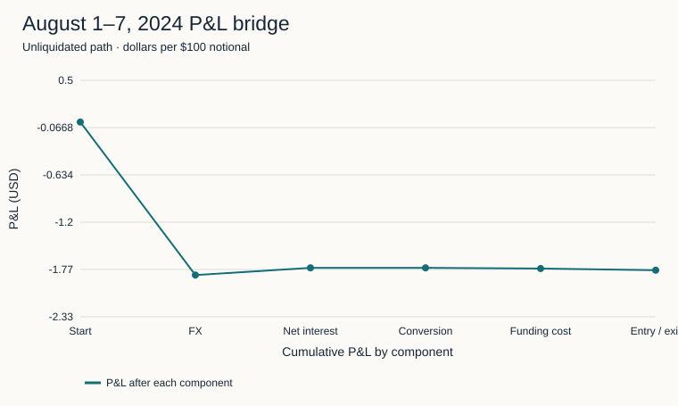

# USD/JPY carry crash lab

At 15× initial leverage and a 50-bp annual funding spread, a 21-observation Gaussian simulation gave an **11.95%** maintenance-margin breach rate. Five-interval resampling gave **11.75%** with a larger 95th-percentile drawdown (76.75% versus 73.30% of initial margin). In the August 2024 replay the 15× position breached and closed down 62.53% against initial margin.



[Leverage and cost sensitivity](report/sensitivity.svg) · [Drawdown distribution](report/drawdown.svg) · [Results and audit](RESULTS.md)

## Reproduce

Use Python 3.11–3.14. Install NumPy in a fresh virtual environment if desired. The download step uses curl.

```sh
git clone https://github.com/NeilMeher/usdjpy-carry-lab.git
cd usdjpy-carry-lab
python -m pip install -r requirements.txt
python -m unittest -v
python study.py --quick --output pilot
python study.py --download --output report
```

The study validates hashes of the historical slices identified in [SOURCES.md](SOURCES.md). You can supply matching original CSVs with `--data`. The tested source version was retrieved November 18, 2026. No raw vendor observations are committed. The [protocol](PROTOCOL.md) and [experiment log](EXPERIMENT.md) describe the comparison.

Neil Meher commissioned the study and set verification requirements. Codex assembled the data workflow, simulation and figures, and ran the checks. Neil's independent review is pending.
